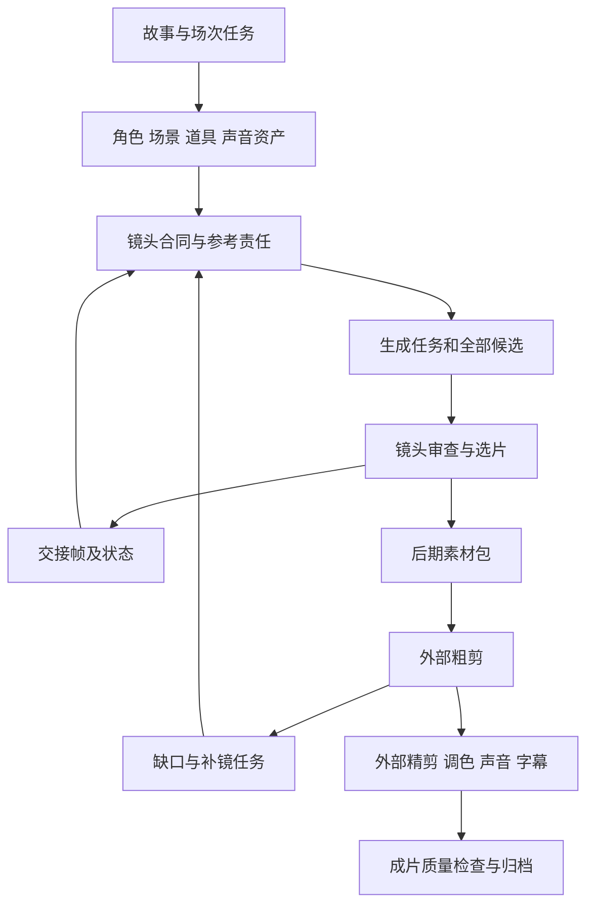

# 惊夜完整生产流程与输入输出分析

## 故事组织

根据画布命名与表演说明，本案例属于古装悬疑剧情制作：资产涉及刘信七、刘仪、陈守成、王大头、杨氏、沈磊及戏班、药铺和官府人物；关键物件包括银镯、钥匙、钱袋、包裹、刀具和囚车。场次涉及取镯、夜间拜访、慌张归铺、审讯、求情、押赴刑场与归来。

可判断它需要管理多人物、多地点、服装变化、昼夜、线索道具和因果链。不能只从场次名称确认谁是凶手、谁在说谎、事件先后或最终结局。侧栏顺序不是成片顺序，节点数量不是剪辑镜头数量。

本地应将故事拆成四份关联记录：事件发生时间、观众获知时间、人物知情状态、道具流转。每场次记录目标、阻力、转折、结束状态和新信息；每镜至少服务一项故事任务。

## 流程图

这是结合画布证据、用户后期说明和本地建议重建的生产流程，不代表所有步骤在原项目中均按此顺序执行。

## 步骤合同

| ID与阶段 | 输入 | 制作动作 | 输出与交接 | 质量门禁 |
|---|---|---|---|---|
| W00 F0 立项 | 题材、受众、故事、资源和授权 | 明确规模、规格、质量参照 | brief与边界 | 原项目具体预算和立项记录未知；本地必填 |
| W01 F1 拆场 | 剧本、人物与线索 | 拆场次任务、信息与行动因果 | 场次卡、镜头任务 | 角色行为和场次变化可解释 |
| W02 F2–F3 角色 | 定妆、服装、身份与状态 | 形成角色母版和囚服/便装/戏服状态 | 指定版本角色板 | 身份与剧情状态不混淆 |
| W03 F2–F3 场景道具 | 空间、时代、照明、道具要求 | 建内外昼夜场景及关键物件 | 场景母版、道具参考 | 空间、主光、纹样和尺度能交接 |
| W04 F3 声音 | 台词、角色声线、戏曲和音乐 | 编号、绑定、明确入出点 | 对白总账与声音资产 | 角色、句子、版本和来源明确 |
| W05 F4 镜头合同 | 镜头任务、资产、交接状态 | 组织14类控制信息 | 制作合同、适配后的实际提交文本 | 参考职责明确，无互相冲突要求 |
| W06 F5 生成 | 实际参考、原文、模型及参数 | 提交、保留候选与运行记录 | 原始候选、技术信息 | 身份、动作、空间与可剪区间审查 |
| W07 F5 接戏补镜 | 选片、首尾/中间帧、问题记录 | 选取合格交接帧、重拍、补反应/道具镜头 | 新候选与依赖变更 | 不把缺陷帧继续传播 |
| W08 F6 后期交接 | 选用镜头、声音、状态及缺陷 | 整理原始/处理版和选用入出点 | 后期素材包 | 路径、版本、规格和问题齐全 |
| W09 F6 外部后期 | 素材包与导演要求 | 粗剪、补镜反馈、精剪、调色、混音、字幕 | 后期工程、成片、分轨 | 用户确认外部完成；具体软件工程未知 |
| W10 F7–F8 审查归档 | 成片与生产记录 | 分层审查、交付、回写方法库 | 母版与审查档案 | 本次只定义要求，未做成片验收 |

W00、W10及若干记录字段为本地补强建议。W01–W08的组织线索来自工作台，但实际执行参数和部分先后关系未知。

## 镜头合同与输入控制

画布模板包含项目规格、导演意图、参考责任、空间走位、对白、表演、时间轴、摄影剪辑、动作因果、美术光线、声音、情绪连续、负面约束和最终QA。

本地分两层保存：完整合同用于生产与审查，提交文本按具体模型的参考数量、时长、声音能力和控制接口适配。焦段、负面约束、台词执行等文字要求只是意图，不是物理或模型保证。

参考责任必须绑定实际文件：场景负责空间和光线；角色负责身份与状态；道具负责形制和尺度；交接帧负责接戏；音频负责指定声线或台词。模板Mixed编号不是实际上传顺序，也不能自动推断每条连线的控制强度。

## 外部工具

LibTV工作台已确认。导入文件名中有jimeng和sd2.5-pe字样，模型/版本仍需实际节点证明；/sd25-pe为模板标记，不能当成可调用Skill。图像、配音、音乐、去字幕、1080P处理与外部剪辑的实际引擎均未完整核实。本次不新增安装，不调用生成服务。

## 质量标准

| 维度 | 方法设计证据 | 本地验收要求 | 实际输出状态 |
|---|---|---|---|
| 故事 | 导演意图与观众信息字段 | 线索有依据、因果可追溯、每场有变化 | 未审 |
| 表演 | 目标、阻碍、策略、情绪节拍 | 动作由目标触发，转折能被看懂 | 未审 |
| 身份 | 角色资产与造型状态板 | 人脸、服装、体型与声音跨镜稳定 | 未审 |
| 空间 | 走位、轴线、场景责任 | 视线、出入口、柜台与运动方向连续 | 未审 |
| 道具 | 独立银镯等资产和动作因果字段 | 持握、纹样、位置与流转可接 | 未审 |
| 声音 | 声线资产、对白编号与声音字段 | 无重复串角，语言清楚，同步与空间合理 | 未听审 |
| 美术 | 时代、主光和材质字段 | 昼夜、光源、造型与历史设定统一 | 未审 |
| 技术 | 处理版本命名与播放器标签 | 对实际文件检测编码、时长、帧率和同步 | 未检测 |
| 权利 | 本次未获得完整授权资料 | 素材、声音、音乐和输出用途可追溯 | 未核实 |

质量分为BLOCK阻断、FIX返工、NOTE观察和PASS通过；不以单一总分掩盖身份、故事或权利硬缺口。标准为本地研究建议，不冒充原作者实际评分体系。

## 成本与风险

原项目成本、人工时、生成时长和成功率未知，不引用评论估价。大量副本也可能是编辑、裁切或输出派生，不能都算失败。

重点风险：多参考职责冲突；过长提示词导致动作遗漏；不合格尾帧传递身份和姿势错误；多个计划切点生成不可独立使用；候选名称泛化导致选片错误；只管理图像而忽略对白与声音；外部后期返工未回写工作台。

优化原则：先解决最影响下游的缺陷；能用移切点、替换候选或补短镜解决时，比较后再决定是否整段重生成。每次方案取舍记录质量、成本和可编辑性。

