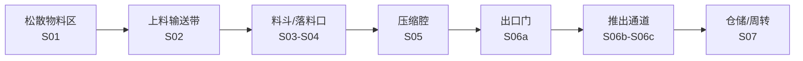

# 连续故事分镜 v001

日期：2026-10-22。画幅9:16，目标时长55秒，24fps。风格比例采用独立评审建议：A纪实主干约65%、B英雄镜头约25%、C受控概念剖切约10%。

## 一句话故事

跟随同一批松散废料穿过一座真实工厂：它从占据空间的混乱状态进入连续生产线，在可见驱动力作用下被压缩、开门、推出，最终变成便于堆放和周转的规整料包。

## 连续性合同

- 物料方向始终为画面左/上方进入，向右/下方完成输出；若相机换轴，必须用运动匹配转场交代。
- 松散物料、压缩中物料和成品包保持相同的牛皮纸、白塑料和少量蓝红碎片配色，证明是同一批物料。
- 设备保持蓝色主体、黄色安全件；Logo、型号、参数、认证和控制界面文字后期确定性合成。
- 压缩段严格继承Blender v003顺序：进料停止 → 压板持续接触 → 物料逐步缩短 → 门完全开启 → 推出板接触 → 料包移动。
- C类剖切只解释材料密度变化，不声明未经确认的管线、锁止或内部构造。
- 每个镜头结尾留下一个运动、形状或声音线索，作为下一镜头开头的匹配点。

## 八个故事节点

| 镜头 | 时间 | 风格 | 画面与动作 | 上一镜输出 → 本镜输入 | 声音动作点 | 质量门槛 |
|---|---:|---|---|---|---|---|
| S01 混乱有体积 | 0–5s | A | 微距穿过蓬松纸塑废料，前景遮挡快速掠过，远处蓝色设备只露出轮廓 | 无 → 同一批混合废料 | 纸张摩擦、远处厂房低频 | 不用事故、脏乱恐吓或数据文案 |
| S02 进入秩序 | 5–11s | A | 镜头贴近一片蓝色塑料碎片随输送带上升，厂房纵深和设备逐渐显露 | S01蓝色碎片 → 输送带上的同一碎片 | 输送机启动、链条节奏 | 输送方向与落料口连续可见 |
| S03 机器苏醒 | 11–17s | B | 低机位绕至设备三分之四侧面，液压机构启动，蓝色机器成为英雄主体 | S02输送带斜线 → 设备轮廓线匹配 | 电机启动、低频上升 | 强逆光不能遮掉结构和安全件 |
| S04 落料入腔 | 17–24s | A | 相机越过料斗边缘，跟随物料进入压缩区域；人物只在安全区作尺度参照 | S03设备入口 → 物料进入同一入口 | 物料跌落、输送连续声 | 人物PPE和距离待品牌复核 |
| S05 压缩发生 | 24–32s | C→A | 外壳局部退去，压板保持接触并持续推进；散料经历两个中间密度状态，再匹配回真实外观 | S04散料 → 同色同纹理连续压缩 | 液压上升、峰值闷响 | 不得瞬间替换成方包；不显示未经证实结构 |
| S06 门开与推包 | 32–40s | A | 门先完全升起；推出板接触料包后才向外移动；镜头随料包平移 | S05密实物料 → 规整料包 | 门锁释放、金属停止、推包摩擦 | 必须看见驱动力、接触顺序和运动轴线 |
| S07 空间被重组 | 40–49s | A | 料包沿通道离开，匹配切到叉车/仓储位置；多个料包形成稳定纵深，仍保留现场磨损与粉尘 | S06单包 → 仓储中的同一包 | 叉车提示音、空间混响展开 | 不虚构压缩比、产能或节省金额 |
| S08 机器与结果 | 49–55s | B | 规整料包前景擦过形成遮挡转场，回到完整设备英雄镜头；最后只留真实Logo/CTA安全区 | S07矩形料包 → 矩形遮挡揭示设备 | 音乐收束、液压余响停止 | 不生成品牌字；CTA内容待品牌确认 |

## 转场设计

1. S01→S02：以同一片蓝色碎片做物体匹配。
2. S02→S03：输送带斜线匹配设备上料结构斜线。
3. S03→S04：相机沿设备轮廓向上，越过料斗边缘进入主观跟随。
4. S04→S05：物料撞击的声音峰值触发局部剖切，空间位置不改变。
5. S05→S06：液压峰值后的短暂停顿，随后门锁释放；避免用闪白掩盖状态跳变。
6. S06→S07：保持料包向右运动，用形状和速度匹配进入仓储通道。
7. S07→S08：前景料包遮满画面，再由相同矩形边缘揭示设备英雄镜头。

## 俯视空间轴线草案

屏幕运动基准为左/上进入、右/下输出。S01–S07默认不跨越运动轴；若S03英雄环绕越轴，必须在设备正侧面经过中性机位，并以输送带和物料方向重新建立方位。S08是结果后的品牌收束，不再把时间倒回S03的启动状态。

## S05–S06动作细分门禁

| 子状态 | 必须看见 | 禁止跳步 |
|---|---|---|
| S05a 接触 | 压板首次接触仍蓬松的同一批物料 | 不能提前出现规整料包 |
| S05b 初压 | 压板推进，物料沿受力轴缩短，蓝色碎片仍可辨 | 不能更换材质或颜色 |
| S05c 高密 | 体积继续缩短，边缘变密但尚未完全定形 | 不能用闪白掩盖替换 |
| S05d 定形 | 压板停止，料包尺寸稳定，随后才允许门动作 | 门不能在压缩未完成时开启 |
| S06a 开门 | 出口门解锁并完全离开通道 | 料包不能提前移动 |
| S06b 接触 | 推出板先接触料包背面 | 不能出现无接触驱动 |
| S06c 推出 | 推出板与料包同步移动，轴线一致 | 不能自滑、穿透或瞬移 |

## 当前未知

精确机型、真实进料方向、压板与推出机构结构、门锁动作、捆扎发生时点、设备尺寸、人员安全距离、工厂实拍条件、Logo文件、CTA、旁白、音乐和产品性能数据均未获品牌确认。分镜只锁定叙事与电影语言，不把这些未知项转写成事实。
